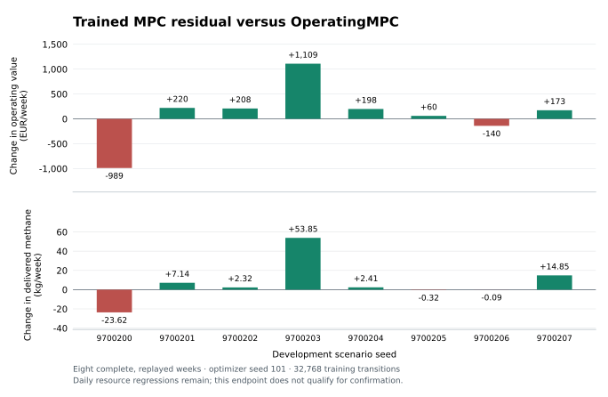

# Adaptive batch 003: MPC residual learning with paired regressions

Closed development evidence, 2026-09-13. **This policy does not qualify for
confirmation.** It completed every scenario and retained the incumbent's hard
safety pass, but its small positive mean operating-value difference includes
worsened individual deliveries and daily resource deficits. No operational-benefit,
algorithm-level, commercial, site-generalization or live-deployment claim follows.
The original registered study and protected seeds remain unopened.

## Fixed experiment and closure

The [prospective protocol](../ADAPTIVE_RL_BATCH_003_PROTOCOL.md) fixed one fresh
scalar PPO policy around OperatingMPC, optimizer seed 101, 32,768 transitions,
four synchronous environments, four rollouts and 1,280 minibatch updates.
Optimizer rewards were raw EUR multiplied by 0.001. Initial action standard
deviation was 0.2 and the actor output head was exactly zero. Training used the
52 allocator seeds 9,620,000–9,620,051; evaluation used all eight fresh development
seeds 9,700,200–9,700,207.

The task remained **6,720 kg methane in 28 deliveries over 168 hours**, with the
same public observations, stochastic weather/prices/outages, minute physics,
15-minute decisions, dispatcher, guard, operator authority and daily settlements.
The 139-input policy adds four causal cached MPC targets to the 135 physical
inputs. Bounded residuals preserve zero targets and the prior's low-power commands.
All eight initial-policy trajectories exactly match native MPC after the frozen,
explicit solver-clock/hash projection; equality includes minute physics and every
settlement. The final-versus-initial comparison therefore isolates learned changes
within this fixed interface. Comparisons with previous batches do not isolate the
prior, action range, budget or seed changes.

Execution used clean source `4072959f7093ddf672b08386929330545dc98658`, tree
`a35996b263e1ccc4651313d4693d053de5ccf78b`. The launch at 2026-09-12T20:50:04Z
closed normally at 2026-09-13T05:32:34Z. Training took 15,617.84 seconds
(about 4 hours 20 minutes), below its fixed six-hour cap. All 97 process receipts
closed without custody codes: one training, 48 evaluations and 48 detached replays.
The audit bound 603 artifacts. There are 32 complete weeks and 16 retained stopped
comparator prefixes; no prefix contributes a weekly comparison mean.

## Complete-panel results

| Actor | Complete/replayed | Strict safety | All daily returns | Mean delivery fill | Mean EUR/week |
|---|---:|---:|---:|---:|---:|
| H | 8/8 | 6/8 | 0/8 | 91.10% | -3,804.60 |
| OperatingMPC | 8/8 | 8/8 | 0/8 | 93.26% | 1,960.86 |
| M24 | 0/8 | 0/8 | 0/8 | unavailable | unavailable |
| E-beta | 0/8 | 0/8 | 0/8 | unavailable | unavailable |
| Initial MPC residual | 8/8 | 8/8 | 0/8 | 93.26% | 1,960.86 |
| Trained MPC residual | 8/8 | 8/8 | 0/8 | 93.36% | 2,065.84 |

The trained policy had zero forced or aborted starts in all eight weeks, as did
its native-MPC initialization. This is a retained safety result for this screen;
it does not establish that learning caused the incumbent's safety behavior.
H had one forced/aborted start in each of seeds 9,700,200 and 9,700,201.

All M24 attempts stopped when a private DAC outage became publicly observable,
with `ServiceMPCInputError` for unsupported degraded/offline DAC. All E-beta
attempts stopped at the opening solve with infeasibility. Their saved physical
prefixes and exception evidence remain available; these failures supply no
numeric PPO advantage.

## Paired interpretation

Against its exact initialization and native MPC, the trained policy gained
**EUR 104.98/week on average**, with six positive and two negative value pairs.
The worst pair lost EUR 988.52 and delivered 23.62 kg less methane. Individual
service and resource regressions disqualify this endpoint regardless of its mean.
Against H, mean value was EUR 5,870.44 higher, but the worst pair lost
EUR 2,019.09 and the minimum paired weekly delivered-mass difference was
-323.10 kg. The stronger incumbent remains the relevant additional-value test.

Every individual delivery and daily resource vector is retained in the
[compact evidence](adaptive_rl_batch_003_results.json). Maximum worsened daily
deficits relative to native MPC were 306.915120 kWh battery, 29.742829 kg H2,
131.026322 kg CO2 and 56.798541 kg methane. These are resource-specific maxima,
not a single simultaneous boundary. All actors still fail absolute restoration
in every complete week. The parent protocol permits a carefully scoped gain with
unresolved absolute restoration only if individual deficits do not worsen;
this policy does not satisfy that condition.

## Learning and operating mechanisms

The mean gain comes from **7.066 kg/week more delivered methane**, contributing
EUR 169.593 in service value and avoided shortfall penalties. Additional battery
throughput of 1,106.764 kWh/week consumes EUR 62.884 in modeled battery wear;
solar opportunity cost rises EUR 9.490. Modeled electrolyser wear improves
EUR 6.994 and endowment-liability changes improve EUR 0.770. This does not establish
cost savings at preserved service. All eight paired decompositions remain available.

Of 224 deliveries, 26 improve, 17 worsen and 181 are exactly equal against MPC.
Daily battery/H2/CO2/CH4 deficits worsen at 34/31/17/9 of the 56 boundaries,
respectively. Counts use the exact saved sign, including numerical dust, without
a new materiality tolerance. Every scenario has some larger resource deficit.
Dawn deliveries account for 32 of the trained policy's 38 shortfall events.
Mean daily delivery declines from 960 kg on cycle 1 to 795.645 kg on cycle 7
while starting stocks deplete; varying weather, prices and outages coexist with
that pattern, so depletion is not isolated as its only cause.

The saved learning diagnostics show a functioning update path. All 1,280
optimizer steps completed. Pre-update reward explained variance progressed
-0.314592, 0.677696, 0.864409, 0.884058; sampled Gaussian standard deviations
remained 0.19551–0.20539, with no observed action-bound clipping in those samples.
The critic was not wholly saturated. Four pre-update snapshots do not measure
the final updated critic or establish convergence, and training-return sums from
different episodes are not a controlled learning curve.

Final deterministic residuals were small (maximum absolute value 0.075524).
They changed some target above 1e-9 kW at 2,508 of 5,376 decisions; 2,868 changed
none at that numerical tolerance. Only 201 decisions had battery-ceiling authority
above that tolerance. Zero/floor/cap restrictions and state feedback matter:
a small downward same-state charge-ceiling residual coexisted with more actual
battery cycling than the independently visited native-MPC trajectory. Requested
kW times interval duration is not applied energy or an operating-value estimate.

The nominal prior on the final trajectory accepted 5,329 **recovery plans** and
used 47 fallbacks, versus 5,344 and 32 for native MPC. Recovery denotes a successfully
solved plan with current/projected inventory deficits or shortfalls. It is not a
solver failure. All fallback records reported infeasibility; their evidence does
not by itself distinguish physical incompatibility from numerical or lexicographic
lock issues. No fallback was excluded from evaluation.

Solar mean/p10 feature correlations exceed 0.997 in these traces. At all 283
publicly offline DAC boundaries, nominal and issued DAC targets were zero even
when raw residuals varied. Neither observation establishes causal use of forecast
quantiles or learned fault recovery. Both independent diagnoses preserve every
seed and their input digests.

The next design must distinguish insufficient training budget from the missing
separate daily-constraint objective in scalar PPO. Existing PI/I machinery can
consume the unchanged four physical cost channels through this exact wrapper;
no such next experiment has been launched as part of this closed screen. Scalar
EUR already includes aggregate methane-equivalent inventory liability involving
H2/CO2, so absence of separate daily H2/CO2 constraints is not absence of every
inventory incentive. More training, a wider action range or adding multipliers
cannot be presumed to fix the observed regressions.

## Audit correction and validation

The original frozen post-run auditor stopped before performance analysis because
it expected `ignored_framework_seed = optimizer_seed + environment_index` on
initial resets. The actual fixed `ConstrainedPPO.set_random_seed` override seeds
optimizer RNG and action space only. The vector environment therefore supplies
null framework-reset seeds; the allocator alone selects physical episode seeds.
All 52 saved reset records and four allocator prefixes follow the frozen physical
seed mapping and final 8,192 decisions per environment.

A versioned external auditor correction requires null framework-reset metadata
for this producer. It does not accept both conventions or change physical seed,
order, progress, checkpoint, source, replay or outcome checks. The original failed
audit, original tools, correction diff, custody-only input hashes and validation
note remain preserved. The experiment itself was not modified or retried.
The corrected auditor then passed the complete closed-artifact graph before the
unchanged reporter opened performance results.

The exact-revision admission gate passed **751 Python tests in 1,033.30 seconds**,
plus Black, strict source mypy, compilation, CLI and whitespace checks. The full
repository/frontend gate was not repeated; the inherited complete gate remains
`b5ea55e`. Original auditor/reporter fabricated suites passed 64 and 60 tests.
The corrected auditor passed 72 fabricated tests in 346.72 seconds, including
8 new seeding-contract regressions, plus source mypy, Black, compilation and CLI.
An optional mypy run on the inherited untyped fixture suite failed annotation
checks; it was outside the source-only admission gate and is retained in the
correction note.

Raw trajectories, checkpoints, training diagnostics and process records remain
outside Git under `/Volumes/Lexar/PlantAnAgentResearch/adaptive-rl-batch-003`.
The analysis directory beside it retains original/corrected audit evidence and
the complete descriptive report. The compact JSON binds these artifacts by digest;
[archived analysis tools](../tools/adaptive_batch_003/README.md) preserve the checked
original and corrected implementations.
